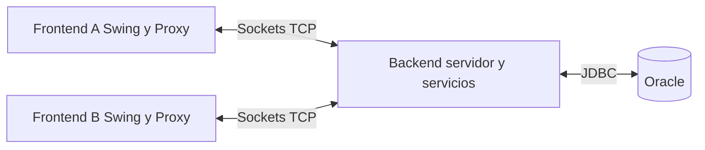
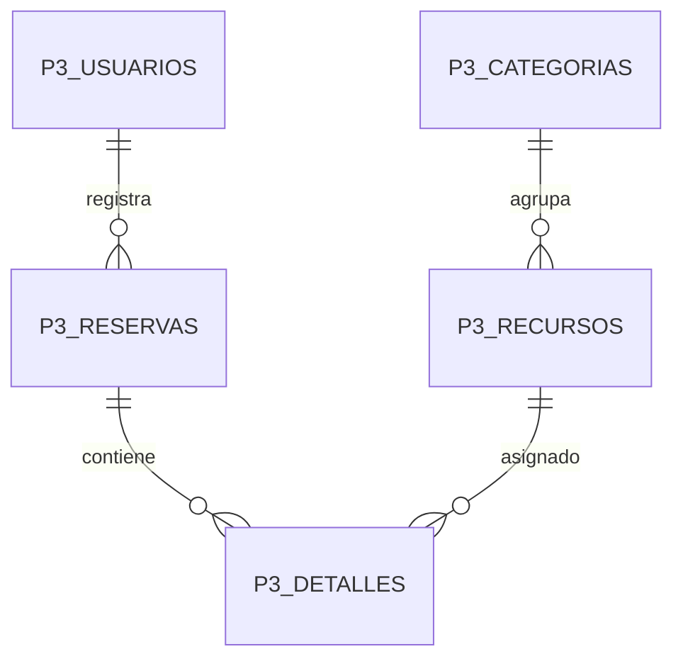

# Sistema de reserva de recursos

Proyecto 2 de **EIF206 Programación 3**, Universidad Nacional, II ciclo de 2026.

Aplicación de escritorio para administrar recursos, reservarlos para actividades y consultar su ocupación. Permite gestionar funcionarios, categorías y recursos, consultar calendarios y estadísticas, generar reportes PDF y recibir alertas cuando otros usuarios registran reservas.

El sistema tiene **dos programas que se ejecutan por separado**:

- **Backend:** servidor de consola que atiende a los clientes y guarda los datos en Oracle.
- **Frontend:** ventana de escritorio Java Swing que utiliza cada usuario.

Varios frontend pueden conectarse a un mismo backend mediante sockets TCP. Solo el backend accede a la base de datos.

## Integrantes

- Maria Belen Sandoval Mendez
- Juan José Fernández Campos

## Contenido

- [Antes de comenzar](#antes-de-comenzar)
- [1 Obtener el proyecto](#1-obtener-el-proyecto)
- [2 Abrir y preparar el proyecto](#2-abrir-y-preparar-el-proyecto)
- [3 Preparar Oracle](#3-preparar-oracle)
- [4 Configurar la conexión](#4-configurar-la-conexión)
- [5 Crear las tablas y cargar los datos](#5-crear-las-tablas-y-cargar-los-datos)
- [6 Iniciar el servidor y la aplicación](#6-iniciar-el-servidor-y-la-aplicación)
- [7 Ingresar y realizar la primera reserva](#7-ingresar-y-realizar-la-primera-reserva)
- [8 Probar las alertas con dos clientes](#8-probar-las-alertas-con-dos-clientes)
- [Manual de las demás funciones](#manual-de-las-demás-funciones)
- [Consultar los datos en Oracle](#consultar-los-datos-en-oracle)
- [Conectar clientes desde otra computadora](#conectar-clientes-desde-otra-computadora)
- [Configurar la asistencia de IA](#configurar-la-asistencia-de-ia)
- [Pruebas automatizadas](#pruebas-automatizadas)
- [Arquitectura y organización](#arquitectura-y-organización)
- [Modelo de datos](#modelo-de-datos)
- [Compilación y archivos JAR](#compilación-y-archivos-jar)
- [Solución de problemas](#solución-de-problemas)
- [Archivos locales y datos de demostración](#archivos-locales-y-datos-de-demostración)

## Antes de comenzar

Esta guía explica la ejecución desde las fuentes en Windows, con IntelliJ IDEA o PowerShell. En los ejemplos, **raíz del proyecto** significa la carpeta que contiene `pom.xml`, `src/` y `database/`.

| Componente | Para qué se necesita |
| --- | --- |
| **JDK 21** | Compilar y ejecutar el proyecto. Es la versión objetivo de `pom.xml`; el servidor utiliza hilos virtuales de Java 21. |
| **IntelliJ IDEA** | Alternativa gráfica para abrir Maven y ejecutar las clases. También se puede trabajar con otro IDE configurado para Java y Maven. |
| **Maven** | Descargar dependencias, compilar y ejecutar pruebas. IntelliJ incluye Maven para sus tareas internas; para escribir `mvn` en una terminal debe estar disponible en `PATH`. |
| **Oracle Database** | Persistencia del backend. La instalación utilizada localmente es Oracle Database 11g Express Edition, servicio `XE`. |
| **SQL Developer o SQL Plus** | Consultar Oracle y ejecutar los scripts manualmente. SQL Developer es una interfaz gráfica y SQL Plus una consola. |
| **Git** | Clonar y actualizar el repositorio. Es opcional si se descarga un ZIP de GitHub. |
| **Acceso a Internet en la preparación** | Maven necesita descargar las dependencias que aún no estén en su caché. La función de IA también requiere acceso al servicio externo. |

**Oracle Database y SQL Developer son programas diferentes.** Instalar SQL Developer no instala el servidor de base de datos. Para una prueba completa en un solo equipo, Oracle debe estar instalado y funcionando en ese equipo.

No se necesita una clave de IA para iniciar sesión, reservar manualmente o probar las alertas.

### Si el proyecto ya funcionaba en esta computadora

Conservar `database.properties` y las tablas existentes. Ir a [Iniciar el servidor y la aplicación](#6-iniciar-el-servidor-y-la-aplicación). La creación de tablas y la importación se realizan una sola vez, no cada vez que se inicia el programa.

## 1 Obtener el proyecto

### Con Git

Abrir PowerShell en la carpeta donde se desea guardar el proyecto y ejecutar:

```powershell
git clone https://github.com/belenS-tech/Proyecto2P3.git
cd Proyecto2P3
```

### Sin Git

1. Abrir el [repositorio en GitHub](https://github.com/belenS-tech/Proyecto2P3).
2. Seleccionar **Code > Download ZIP**.
3. Extraer el ZIP antes de abrirlo en el IDE.
4. Localizar la carpeta que contiene `pom.xml`.

La estructura de esta versión coloca `pom.xml` **directamente en la raíz**. El nombre de la carpeta local puede ser distinto si se eligió otro al descargar o clonar.

## 2 Abrir y preparar el proyecto

### Opción A IntelliJ IDEA

1. Seleccionar **File > Open** y abrir la carpeta que contiene `pom.xml`.
2. Si IntelliJ pregunta cómo abrirlo, elegir cargarlo como proyecto Maven.
3. En **File > Project Structure > Project**, seleccionar **JDK 21** como SDK. Si no está disponible, usar **Add SDK / Download JDK**, elegir la versión 21 y esperar a que finalice.
4. En **Settings > Build, Execution, Deployment > Build Tools > Maven**, comprobar que el JDK del importador y del ejecutor de Maven también sea 21. Los nombres pueden variar según la versión del IDE.
5. Abrir el panel **Maven** y pulsar **Reload All Maven Projects**. Esperar a que finalice la descarga e indexación.

Las bibliotecas Oracle JDBC, OpenPDF, JFreeChart, JAXB, Gson, el SDK de Google Gen AI y JUnit se declaran en `pom.xml`. No es necesario agregar los JAR manualmente.

### Opción B Terminal con Maven

Comprobar las herramientas:

```powershell
java -version
javac -version
mvn -version
```

Usar un **JDK**, que incluye `javac`, y verificar que Maven esté utilizando Java 21. Si Windows encuentra Java 8 antes que el JDK, corregir `JAVA_HOME` y `PATH`.

Ejemplo para la terminal actual; sustituir la ruta por la instalación real del JDK:

```powershell
$env:JAVA_HOME = 'C:\ruta\real\al\jdk-21'
$env:Path = "$env:JAVA_HOME\bin;$env:Path"
mvn -version
```

Si `mvn` no se reconoce, usar la opción de IntelliJ o configurar la carpeta `bin` de Maven en `PATH`. Abrir una terminal nueva después de modificar variables de entorno permanentes.

## 3 Preparar Oracle

1. Iniciar Oracle Database. En instalaciones XE 11g de Windows puede aparecer el acceso **Start Database**.
2. Abrir SQL Developer o **Run SQL Command Line / SQL Plus**.
3. Conectarse con el usuario de Oracle que alojará las tablas. Ese usuario necesita permisos para crear tablas e índices y guardar datos en su esquema.

Para reproducir la instalación local con SQL Developer:

| Campo | Valor del ejemplo local |
| --- | --- |
| Nombre de conexión | `Proyecto Programacion 3`, o cualquier nombre descriptivo |
| Usuario | `system`, si se utiliza la misma instalación local |
| Contraseña | La configurada al instalar Oracle |
| Rol | `Default` |
| Tipo de conexión | `Basic / Básico` |
| Host | `localhost` |
| Puerto | `1521` |
| SID | `XE` |

Pulsar **Test / Probar** y después **Connect / Conectar**. Si la instalación usa otro host, puerto o servicio, utilizar sus valores reales. El nombre descriptivo de la conexión no es el nombre de servicio.

Desde SQL Plus también se puede conectar:

```sql
CONNECT system
```

Ingresar la contraseña cuando se solicite. SQL Plus no muestra los caracteres escritos.

**Distinguir las cuentas:** `system` es un usuario de Oracle; `admin`, `123` y `222` son cuentas de la aplicación. Sus contraseñas no tienen por qué coincidir.

## 4 Configurar la conexión

En la raíz del proyecto, copiar `database.properties.example` como **`database.properties`**. En PowerShell:

```powershell
Copy-Item .\database.properties.example .\database.properties
```

Hacer esa copia solo si el archivo local todavía no existe. Abrirlo en el editor y completar:

```properties
db.url=jdbc:oracle:thin:@//localhost:1521/XE
db.user=system
db.password=TU_CONTRASENA_LOCAL
```

- Reemplazar `TU_CONTRASENA_LOCAL` por la contraseña real, **sin agregar comillas**.
- Usar el mismo usuario que ejecutará o ejecutó los scripts SQL.
- La URL de ejemplo usa el nombre de servicio `XE`. Adaptarla a la conexión real si es diferente.
- Confirmar que el archivo no haya quedado como `database.properties.txt` y que esté junto a `pom.xml`.
- Guardar el archivo. Está excluido de Git porque contiene credenciales.

El backend también admite `DB_URL`, `DB_USER` y `DB_PASSWORD` como variables de entorno, y `db.url`, `db.user` y `db.password` como propiedades Java. La prioridad por valor es: **propiedad Java > variable de entorno > archivo**.

Para indicar un archivo de configuración en otra ubicación, usar la opción de VM `-Ddb.config=RUTA`. Para la primera ejecución basta con el archivo en la raíz y el directorio de trabajo correcto.

## 5 Crear las tablas y cargar los datos

### Comprobar si ya existen

Ejecutar con el usuario de Oracle seleccionado:

```sql
SELECT table_name
FROM user_tables
WHERE table_name LIKE 'P3\_%' ESCAPE '\'
ORDER BY table_name;
```

Si aparecen las seis tablas indicadas en [Modelo de datos](#modelo-de-datos), no volver a instalar. Si existe solo una parte, revisar qué ocurrió antes de ejecutar otro script.

### Instalación inicial automática

Con Maven disponible y `database.properties` configurado, ejecutar desde la raíz:

```powershell
mvn compile exec:java "-Dexec.mainClass=database.OracleSetup" "-Dexec.args=install"
```

La utilidad comprueba que **no exista ninguna de las seis tablas** antes de crear el esquema y cargar los datos. Si alguna ya existe, cancela para conservarla.

En IntelliJ, la misma utilidad se encuentra en `src/main/java/database/OracleSetup.java`. Crear una configuración de ejecución de esa clase, establecer **Program arguments: `install`** y **Working directory: la raíz del proyecto**. Ejecutar `OracleSetup` sin argumentos solo verifica; no instala.

Al completar la instalación se espera un mensaje similar a:

```text
Conexión correcta: Oracle Database ...
Tablas creadas e importación completada.
P3_USUARIOS: 4
P3_FUNCIONARIOS: 3
P3_CATEGORIAS: 5
P3_RECURSOS: 4
P3_RESERVAS: 5
P3_DETALLES: 6
```

Las cantidades son las de la carga inicial y cambian al utilizar el sistema.

### Alternativa manual con SQL Developer

Usar **esta alternativa o la automática**, no ambas sobre el mismo esquema:

1. Conectarse al usuario configurado en `database.properties`.
2. Abrir [`database/01_schema.sql`](database/01_schema.sql), asociarlo a esa conexión y ejecutarlo como script con **F5**.
3. Comprobar que finalizó sin errores.
4. Abrir [`database/02_datos_xml.sql`](database/02_datos_xml.sql) y ejecutarlo con **F5** en la misma conexión. El script incluye la confirmación de los datos.

**No repetir los scripts para iniciar el sistema.** La importación es inicial y no combina registros con una base existente. Oracle confirma DDL implícitamente: una creación interrumpida puede dejar tablas parciales. Si ocurre un error, detenerse y revisarlo antes de continuar; no eliminar tablas con datos para intentar resolverlo.

### Verificar una instalación existente

```powershell
mvn compile exec:java "-Dexec.mainClass=database.OracleSetup" "-Dexec.args=check"
```

En IntelliJ, ejecutar `database.OracleSetup` con argumento `check` y directorio de trabajo en la raíz. Debe mostrar la conexión y el número de registros de cada tabla. No modifica los datos.

## 6 Iniciar el servidor y la aplicación

Elegir **una** de las siguientes formas. No iniciar dos backend simultáneamente en el mismo puerto.

### Opción A IntelliJ IDEA

**Primero, el backend:**

1. Desplegar `src > main > java > server`.
2. Abrir **`BackendMain.java`**.
3. Pulsar el triángulo verde junto a `public static void main` y seleccionar **Run**.
4. Si se configura manualmente, usar la clase principal `server.BackendMain`, JDK 21 y la raíz como **Working directory**.
5. Esperar en la consola:

```text
Backend de reservas escuchando en el puerto 5050
```

El backend es un proceso de consola; no abre una ventana gráfica. **Dejarlo ejecutándose.**

**Después, el frontend:**

1. Abrir **`src/main/java/Main.java`**, directamente dentro de `java`.
2. Ejecutar su método `main` con el triángulo verde.
3. Usar la clase principal `Main`, con JDK 21 y la raíz como directorio de trabajo.
4. Se debe abrir la pantalla de ingreso.

Hay otras clases con nombres similares: los puntos de entrada de esta aplicación son **`server.BackendMain` y `Main`**.

### Opción B PowerShell con Maven

Abrir dos terminales en la raíz. Desde el Explorador de archivos, entrar a la carpeta de `pom.xml`, escribir `powershell` en la barra de dirección y presionar Enter. Repetir para la segunda terminal.

En la **terminal 1**, iniciar y mantener activo el servidor:

```powershell
mvn compile exec:java "-Dexec.mainClass=server.BackendMain"
```

Cuando informe que escucha en el puerto 5050, en la **terminal 2** iniciar el cliente:

```powershell
mvn compile exec:java "-Dexec.mainClass=Main"
```

El proceso Maven permanece activo mientras el programa está abierto; esto es normal. No es necesario esperar a un mensaje `BUILD SUCCESS` del servidor para abrir el cliente.

### Opción C Script incluido para Windows

Si el script encuentra el JDK y Maven del equipo, permite ejecutar las mismas operaciones:

```powershell
# Terminal 1
powershell -ExecutionPolicy Bypass -File .\proyecto.ps1 servidor

# Terminal 2
powershell -ExecutionPolicy Bypass -File .\proyecto.ps1 cliente
```

`Bypass` se aplica solo al proceso iniciado. El script busca Java 21 en `%USERPROFILE%\.jdks` y Maven en una ruta de IntelliJ. Algunas versiones usan `plugins/maven-plugin/` en lugar de `plugins/maven/`, por lo que la detección puede fallar. En ese caso, usar IntelliJ o la opción B con Maven configurado; no es necesario modificar el código del programa.

### Cerrar y volver a abrir

Cerrar los clientes desde la ventana o desde **Opciones > Salir**. Luego detener el backend desde IntelliJ o con **Ctrl+C** en su terminal. Para volver a usar el sistema: iniciar Oracle si está detenido, iniciar el backend y abrir el cliente. Los datos permanecen en la base; no volver a importar.

## 7 Ingresar y realizar la primera reserva

### Usuarios de demostración

Estos usuarios se crean mediante `02_datos_xml.sql`:

| ID | Clave inicial | Rol |
| --- | --- | --- |
| `admin` | `admin` | Administrador |
| `123` | `123` | Funcionario |
| `222` | `222` | Funcionario |
| `111` | `123` | Funcionario |

Si una clave ya fue modificada, usar la nueva. No intentar iniciar sesión en la aplicación con `system` y la contraseña de Oracle.

### Qué puede hacer cada rol

| Función | Administrador | Funcionario |
| --- | --- | --- |
| Administrar funcionarios, categorías y recursos | Sí | No |
| Registrar y cancelar reservas propias desde Reservas | No tiene esta pestaña | Sí |
| Consultar Calendarización, Actividades y Estadísticas | Sí | Sí |
| Recibir y consultar alertas de otros usuarios | Sí | Sí |
| Cambiar su clave y cerrar sesión | Sí | Sí |

### Crear una reserva manual

1. Ingresar con **ID `123` y clave `123`**.
2. Abrir **Reservas**.
3. En **Actividad**, escribir `Prueba de reserva`.
4. Elegir una **fecha futura** y un horario, por ejemplo de `10:00` a `11:00`. La hora de fin debe ser posterior a la de inicio.
5. Seleccionar **Laptop Windows** en las categorías requeridas. Para varias categorías, seleccionar las necesarias con Ctrl y clic.
6. Pulsar **Reservar**.
7. Comprobar el mensaje `Reserva registrada correctamente` y la nueva fila en la tabla.

El servidor genera el ID y asigna una unidad disponible por categoría. El usuario solicita categorías, no el identificador de una unidad concreta. Si alguna categoría no tiene recursos disponibles para ese horario, la operación se rechaza completa.

La carga inicial incluye recursos de Laptop Windows, Sala de juntas y Sala para 10 personas. Que una categoría exista no significa que ya tenga unidades registradas.

### Comprobar el resultado

Abrir **Calendarización**, seleccionar la misma fecha y categoría y pulsar **Cargar**. La reserva debe aparecer en el horario del recurso asignado. También se puede consultar desde Oracle, como se explica más adelante.

Las fechas de las reservas iniciales son fijas. Para una demostración conviene crear una reserva nueva con una fecha futura y consultar esa misma fecha, en lugar de depender de la fecha actual del calendario.

### Cancelar una reserva

En Reservas, seleccionar una fila propia y pulsar **Cancelar reserva seleccionada**. El backend valida el usuario y comprueba que la reserva no haya iniciado, utilizando su fecha y hora guardadas.

En la implementación JDBC actual, esta acción **elimina la reserva y sus detalles de la base**, liberando los recursos; no se limita a cambiar el estado a `CANCELADA`. Una reserva pasada o ya iniciada se rechaza. El botón **Limpiar** únicamente restablece el formulario.

## 8 Probar las alertas con dos clientes

La alerta debe recibirse en una sesión que ya esté abierta cuando se registra la reserva.

1. Mantener **un solo backend** activo.
2. Abrir dos instancias de `Main`.
   - En IntelliJ, editar la configuración de ejecución de `Main` y habilitar **Allow multiple instances / Allow parallel run**. No elegir detener la instancia anterior.
   - Con Maven, abrir una tercera terminal en la raíz y repetir el comando del cliente.
3. En el cliente A, ingresar con `123 / 123`.
4. En el cliente B, ingresar con `222 / 222` y dejarlo abierto, incluso en otra pestaña.
5. En A, registrar una reserva con disponibilidad.
6. En B, comprobar que aparece automáticamente en el panel derecho **Alertas de reservas**, sin pulsar Cargar.
7. Seleccionar la alerta y pulsar **Ver alerta** para consultar su detalle.
8. Pulsar **Descartar** y responder a la confirmación. Si se rechaza, la alerta permanece; si se acepta, desaparece del panel local.
9. Consultar la reserva en Calendarización o en Oracle: debe seguir existiendo después de descartar el aviso.

**Descartar una alerta no cancela ni elimina la reserva.** Solo quita el aviso de esa sesión. Las alertas no se envían al autor ni a otra conexión del mismo usuario. Son informativas y pertenecen a la sesión actual: al cerrar sesión no se recupera un historial de alertas anteriores.

## Manual de las demás funciones

### Cambio de clave y sesión

Desde el menú **Opciones**, utilizar **Cambiar clave**, completar clave actual, nueva clave y confirmación y guardar. Para terminar la sesión, seleccionar **Cerrar sesión** y confirmar. **Salir** cierra la aplicación cliente.

### Funcionarios

Ingresar como administrador y abrir **Funcionarios**. Registrar identificación, nombre y teléfono mediante la acción de inclusión de la pantalla. El sistema crea la cuenta del funcionario con clave inicial igual a su ID. Buscar o seleccionar un funcionario para modificar su nombre y teléfono o solicitar su eliminación. El ID no se modifica.

Atender los mensajes de validación y las confirmaciones. Las relaciones con otros datos pueden impedir ciertas eliminaciones; no borrar directamente registros de Oracle para eludir esas validaciones.

### Categorías y recursos

- **Categorías:** representan tipos de recurso, como Laptop Windows. Permiten incluir, buscar, modificar y eliminar; el ID de categoría se genera automáticamente.
- **Recursos:** representan unidades concretas, cada una con ID, descripción y categoría. Permiten administración y filtrado por categoría.

Para disponer de un nuevo tipo de recurso, crear primero la categoría y después sus unidades. Una reserva asigna una unidad por cada categoría seleccionada.

### Calendarización

Elegir fecha y categoría y pulsar **Cargar**. La matriz muestra la ocupación de los recursos por intervalos horarios. Abarca las 24 horas y considera solapamientos, incluso si la reserva ocupa solo parte de una hora. Cambiar filtros y cargar de nuevo para consultar otros datos.

### Actividades

Elegir una fecha de referencia y pulsar **Cargar**. Se muestra la programación semanal correspondiente, con información de actividades y funcionarios. Para localizar una reserva conocida, elegir una fecha dentro de su semana.

### Estadísticas

Indicar **Desde** y **Hasta** y pulsar **Calcular** en la consulta deseada:

- **Recursos:** cuenta las asignaciones de recursos por categoría dentro del periodo; no es una suma de horas reservadas.
- **Actividades:** cuenta reservas por semana e incluye semanas del periodo con cero actividades.

Las consultas incluyen estados `ACTIVA` y `FINALIZADA` y excluyen `CANCELADA`. Revisar fechas y filtros antes de interpretar un resultado vacío.

### Reportes PDF

Pulsar **Imprimir** en el módulo correspondiente, elegir ubicación y nombre y guardar. En las consultas, cargar o calcular primero los resultados para habilitar la exportación. Abrir el PDF y comprobar sus datos. La acción genera un archivo y no requiere impresora física.

## Consultar los datos en Oracle

En SQL Developer, abrir la conexión configurada, desplegar **Tables / Tablas**, abrir **P3_RESERVAS** y seleccionar **Data / Datos**. Actualizar la vista para ver registros recientes.

También se puede ejecutar en una hoja SQL:

```sql
SELECT id, actividad,
       TO_CHAR(fecha, 'DD/MM/YYYY') AS fecha,
       hora_inicio, hora_fin, funcionario_id, estado
FROM p3_reservas
ORDER BY fecha, id;
```

Para relacionar una reserva con sus unidades:

```sql
SELECT r.id, r.actividad, d.recurso_id,
       re.descripcion AS recurso,
       c.descripcion AS categoria
FROM p3_reservas r
JOIN p3_detalles d ON d.reserva_id = r.id
JOIN p3_recursos re ON re.id = d.recurso_id
JOIN p3_categorias c ON c.id = re.categoria_id
ORDER BY r.id, d.recurso_id;
```

Una reserva con varias unidades aparece en varias filas de esta segunda consulta. Si SQL Plus divide las columnas en demasiadas líneas, ajustar la presentación:

```sql
SET LINESIZE 180
SET PAGESIZE 100
COLUMN id FORMAT A18
COLUMN actividad FORMAT A45
```

## Conectar clientes desde otra computadora

Primero comprobar que el sistema funciona localmente. Después:

1. Mantener Oracle y el backend en el equipo servidor.
2. Conectar los equipos a una red que permita comunicación entre ellos.
3. En el servidor, ejecutar `ipconfig` en PowerShell e identificar su IPv4 de la red utilizada.
4. Permitir conexiones entrantes al backend en el puerto TCP `5050` mediante el firewall del equipo servidor, según las reglas de la red.
5. En el otro equipo, preparar JDK y el proyecto. Si solo ejecutará el cliente, no necesita Oracle instalado ni las credenciales de la base.
6. Iniciar el cliente indicando la IP real del servidor. Ejemplo:

```powershell
mvn compile exec:java "-Dexec.mainClass=Main" "-Dserver.host=192.168.1.10" "-Dserver.port=5050"
```

En IntelliJ, colocar en **VM options** de `Main`:

```text
-Dserver.host=192.168.1.10 -Dserver.port=5050
```

Reemplazar `192.168.1.10` por la IP real. Desde otro equipo, `localhost` apunta a ese otro equipo, no al servidor.

El backend escucha por defecto en `0.0.0.0`, puerto `5050`. Si se cambia el puerto, usar el mismo en ambos extremos:

```powershell
# Servidor
mvn compile exec:java "-Dexec.mainClass=server.BackendMain" "-Dserver.port=5051"

# Cliente remoto
mvn compile exec:java "-Dexec.mainClass=Main" "-Dserver.host=192.168.1.10" "-Dserver.port=5051"
```

El puerto de Oracle, normalmente `1521`, es diferente del puerto del backend. Los clientes se conectan al backend, por lo que esta distribución no requiere exponer Oracle a los equipos cliente. La IP y el firewall deben comprobarse en la red donde se vaya a demostrar el sistema.

## Configurar la asistencia de IA

Es una función adicional del formulario de reservas. El usuario escribe una frase y **Extraer** intenta completar actividad, fecha, horario y categorías. Requiere una clave válida del servicio Gemini y que el modelo configurado en el código esté disponible para esa cuenta.

1. Configurar la variable de entorno **`GEMINI_API_KEY` en el proceso del backend**.
2. En IntelliJ: **Run > Edit Configurations > BackendMain > Environment variables**, agregar el nombre y su valor local.
3. Reiniciar el backend para que reciba la variable.
4. Ingresar como funcionario y escribir una frase, por ejemplo: `Reunión mañana de 10:00 a 11:00 con una Laptop Windows`.
5. Pulsar **Extraer**, revisar los datos y corregirlos si hace falta.
6. Pulsar **Reservar** para confirmar el registro.

La extracción no guarda por sí sola una reserva. La clase [`AiReservationService`](src/main/java/service/AiReservationService.java) contiene el nombre del modelo solicitado, actualmente `gemini-3.6-flash`; su presencia en el código no garantiza acceso o disponibilidad del servicio. Si falla por clave, conectividad, modelo o cuota, la reserva se puede completar manualmente. La clave se conserva en el backend y no se publica en el repositorio.

## Pruebas automatizadas

Se utiliza **JUnit Jupiter**, con **Surefire** para pruebas unitarias y **Failsafe** para integración. Ejecutar desde la raíz, con el JDK y Maven configurados.

### Solo pruebas unitarias

```powershell
mvn test
```

### Unitarias e integración sin activar Oracle real

```powershell
mvn verify
```

Las pruebas condicionadas a `oracle.it=true` quedan omitidas. Otras pruebas de integración utilizan archivos XML, datos en memoria o sockets locales; no confundir integración con acceso obligatorio a Oracle.

### Incluir integración contra Oracle real

Con conexión y tablas preparadas:

```powershell
mvn verify "-Doracle.it=true"
```

Esto habilita `OracleRepositoryIT`, `OracleSocketIT` y `ProcesosOracleIT`. Las pruebas crean registros temporales identificados para prueba y realizan su limpieza; usar un entorno destinado a pruebas. Algunas ejecutan interfaces Swing y procesos Java separados, por lo que requieren un entorno de escritorio y permiso para abrir sockets locales. No se necesita iniciar manualmente el backend para esas pruebas: crean los servidores que requieren.

Revisar el resumen de cada ejecución: fallos, errores y pruebas omitidas. Los informes quedan en:

```text
target/surefire-reports/
target/failsafe-reports/
```

Los resultados históricos de otros archivos no sustituyen los informes de la ejecución que se vaya a presentar. Esta guía no certifica una ejecución nueva de toda la suite.

### Comprobación funcional recomendada

| Caso | Resultado esperado |
| --- | --- |
| Ingresar con cuenta de demostración | Se abren las pestañas del rol correspondiente. |
| Registrar una reserva disponible | Se guarda y aparece en Reservas, Calendarización y Oracle. |
| Reservar sin disponibilidad de alguna categoría | Se rechaza sin guardar una reserva parcial. |
| Crear reserva con otro usuario conectado | El segundo cliente recibe una alerta automáticamente. |
| Ver y descartar alerta | Se muestra detalle, se pide confirmación y la reserva sigue en Oracle. |
| Cancelar una reserva propia futura | Desaparece de la base y libera los recursos. |
| Exportar un reporte | Se genera un PDF con la consulta mostrada. |
| Reiniciar backend y consultar | Permanecen los datos guardados en Oracle. |

## Arquitectura y organización



### Componentes

| Paquete o clase | Responsabilidad |
| --- | --- |
| `Main` | Inicia el frontend y muestra el ingreso. |
| `view/` | Componentes y presentación Swing. |
| `controller/` | Eventos del usuario, coordinación con servicios y actualización de vistas. |
| `model/` | Entidades y objetos usados en el intercambio de información. |
| `api/` | Interfaces compartidas de servicios. |
| `client/ServiceProxy` | Proxy dinámico que representa servicios remotos y usa el socket. |
| `client/Services` | Obtiene y comparte la conexión del frontend. |
| `network/Protocol` | Mensajes de petición, respuesta y alerta. |
| `server/BackendMain` | Compone los servicios reales e inicia el servidor. |
| `server/BackendServer` | Atiende conexiones, sesiones, permisos y notificaciones. |
| `service/` | Validaciones y reglas de negocio; incluye clases compartidas que requiere el frontend. |
| `repository/` y `database/` | Acceso JDBC, transacciones, configuración y conexiones Oracle. |
| `report/` | Generación de PDF. |
| `src/test/java/` | Pruebas unitarias y de integración. |

La presentación sigue MVC: las vistas muestran controles y resultados, los controladores coordinan las acciones y el modelo representa la información. El frontend solicita operaciones mediante interfaces; el **Proxy** convierte esas llamadas en mensajes hacia los servicios del backend.

### Recorrido de una reserva y su alerta

1. `ReservaController` recoge los datos y solicita categorías mediante `api.ReservaService`.
2. `ServiceProxy` envía una petición identificada al backend.
3. `BackendServer` verifica sesión y rol y asigna el ID bajo la coordinación de escrituras.
4. `ReservaService` busca recursos disponibles y guarda la reserva y los detalles mediante repositorios JDBC dentro de una transacción.
5. El backend responde al solicitante y notifica a otros usuarios autenticados.
6. El hilo receptor del cliente distingue respuestas de alertas; la actualización visual se realiza en el hilo de eventos de Swing.

El servidor utiliza hilos virtuales, sesiones por conexión y colas de salida. El acceso a Oracle reutiliza conexiones mediante un pool. La coordinación de escrituras, las transacciones y el bloqueo de recursos protegen la asignación frente a solicitudes concurrentes.

### Estructura de archivos

```text
Proyecto2P3/
├── README.md
├── pom.xml
├── proyecto.ps1
├── database.properties.example
├── database/
│   ├── 01_schema.sql
│   ├── 02_datos_xml.sql
│   ├── exportar_xml.py
│   └── migracion_ids.txt
├── src/
│   ├── main/
│   │   ├── java/
│   │   └── resources/
│   └── test/java/
├── DISTRIBUIDO.txt
└── ORACLE.txt
```

`database.properties` y `target/` se generan o preparan localmente. Los archivos XML heredados se conservan como referencia y para pruebas; **no son la persistencia activa de la aplicación**. Editarlos no actualiza Oracle. `exportar_xml.py` regenera el script de importación desde los XML, pero no sincroniza una base ya instalada.

## Modelo de datos

| Tabla | Clave y contenido |
| --- | --- |
| `P3_USUARIOS` | PK `id`; clave y rol. |
| `P3_FUNCIONARIOS` | PK `id`; nombre y teléfono. |
| `P3_CATEGORIAS` | PK `id`; descripción del tipo de recurso. |
| `P3_RECURSOS` | PK `id`; FK `categoria_id`; descripción de una unidad. |
| `P3_RESERVAS` | PK `id`; actividad, fecha, horas, FK `funcionario_id` hacia usuarios y estado. |
| `P3_DETALLES` | PK compuesta `reserva_id, recurso_id`; FK a reservas y recursos. |



`P3_FUNCIONARIOS` y `P3_USUARIOS` comparten IDs en las cuentas de funcionarios y sus cambios se coordinan en los servicios; el script no declara una FK entre ambas tablas. El campo `funcionario_id` de reservas referencia **usuarios**, no la tabla de funcionarios.

El esquema admite estados `ACTIVA`, `CANCELADA` y `FINALIZADA`, valida el orden del horario y aplica integridad referencial. La cancelación desde la interfaz elimina físicamente la reserva en esta versión. Los detalles se eliminan con ella mediante `ON DELETE CASCADE`.

## Compilación y archivos JAR

Para compilar sin iniciar las ventanas:

```powershell
mvn compile
```

Para empaquetar sin ejecutar pruebas:

```powershell
mvn package "-DskipTests"
```

Se generan en `target/`:

- `ProyectoP3-1.0-SNAPSHOT.jar`
- `ProyectoP3-1.0-SNAPSHOT-frontend.jar`
- `ProyectoP3-1.0-SNAPSHOT-backend.jar`

El JAR frontend excluye repositorios, servidor y acceso a base de datos. **Estos JAR no incluyen todas sus dependencias.** No se presentan como ejecutables autónomos para abrir con doble clic; para ejecutar desde las fuentes seguir los pasos de IntelliJ o Maven descritos arriba. Empaquetar con `-DskipTests` no certifica que las pruebas hayan pasado.

## Solución de problemas

| Mensaje o situación | Qué revisar |
| --- | --- |
| `mvn` no se reconoce | Maven no está en `PATH`. Usar el panel Maven de IntelliJ o configurar su instalación. |
| `invalid target release: 21` o `release version 21 not supported` | Maven está usando un JDK anterior. Revisar `mvn -version`, `JAVA_HOME` y el JDK del ejecutor en IntelliJ. |
| `package ... does not exist` | Recargar el proyecto Maven y esperar la descarga. Gson ya está declarado en `pom.xml`; no duplicar dependencias. |
| El script no encuentra Maven | La ruta interna de IntelliJ puede diferir. Usar IntelliJ o Maven configurado en terminal. |
| PowerShell bloquea `proyecto.ps1` | Usar los comandos Maven o la invocación de PowerShell con `-ExecutionPolicy Bypass` indicada en la guía. |
| `Configure db.user y db.password` | Crear o completar `database.properties` junto a `pom.xml` y revisar el directorio de trabajo. |
| `ORA-01017` | Usuario o contraseña Oracle incorrectos. Probarlos en SQL Developer y revisar valores que puedan venir del entorno. |
| `ORA-12514`, `ORA-12505` o error del adaptador de red | Comprobar Oracle iniciado, listener, host, puerto y nombre de servicio/SID. No usar el nombre descriptivo de SQL Developer como servicio. |
| `ORA-00942` o faltan tablas | Conexión al esquema equivocado o instalación incompleta. Verificar `USER_TABLES` antes de instalar. |
| El instalador informa que ya existe una tabla | No repetir la carga. Verificar si la base ya está lista o si hubo una instalación parcial. |
| No se pudo conectar al servidor | Iniciar primero BackendMain. Revisar IP y puerto del backend; no utilizar el puerto 1521 de Oracle como puerto del cliente. |
| `Address already in use` / puerto ocupado | Probablemente hay un backend activo. Usar el existente o detener la instancia anterior antes de abrir otra. |
| Al abrir otro cliente se cierra el primero | Habilitar múltiples instancias de Main en IntelliJ o usar terminales separadas. |
| No aparece Reservas | La cuenta administradora no tiene esa pestaña. Ingresar como funcionario. |
| No hay disponibilidad | Puede no haber unidades de esa categoría o estar ocupadas. Elegir otro horario o registrar recursos desde administración. |
| La reserva no aparece en calendario | Comprobar fecha, categoría y carga de la consulta. Los datos iniciales tienen fechas fijas. |
| No llega una alerta | Abrir el segundo cliente antes de reservar e ingresar con un usuario distinto. Las alertas anteriores al ingreso no se recuperan. |
| No se puede cancelar | Debe ser una reserva propia futura que aún no haya iniciado. |
| Se pierde la conexión | Cerrar y volver a abrir el cliente. Consultar si la escritura se guardó antes de repetirla para evitar duplicados. |
| Falla Extraer | Revisar clave en el backend, red y disponibilidad del modelo. Completar la reserva manualmente. |

## Archivos locales y datos de demostración

- No publicar `database.properties`, contraseñas de Oracle ni `GEMINI_API_KEY`. Compartir la plantilla, no las credenciales reales.
- No confundir las cuentas iniciales de demostración con las credenciales de Oracle. La implementación conserva el formato de claves del proyecto; no se describe como un sistema de autenticación para producción.
- Dos instalaciones de Oracle independientes no se sincronizan. Las pruebas hechas contra `localhost` utilizan la base de esa computadora y no la de otro integrante.
- Para compartir los mismos datos, conectar todos los frontend al mismo backend.
- Los scripts SQL forman parte del proyecto; no se requiere recibir una base exportada de otro integrante para iniciar con los datos de demostración.
- Antes de preparar una entrega, conservar las fuentes, `pom.xml`, scripts SQL, plantilla y documentación. Los archivos compilados de `target/` y las configuraciones personales del IDE no sustituyen las fuentes.

Se puede consultar el detalle técnico adicional en [`DISTRIBUIDO.txt`](DISTRIBUIDO.txt), [`ORACLE.txt`](ORACLE.txt) y los scripts de [`database/`](database/). Sus anotaciones históricas sobre entregas o publicación no sustituyen el estado actual del repositorio.
